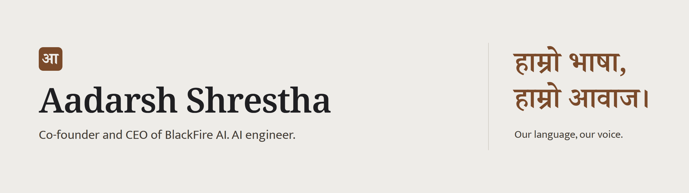

<picture>
  <source media="(prefers-color-scheme: dark)" srcset="assets/banner-dark.png">
  
</picture>

I'm Aadarsh Shrestha, co-founder and CEO of [BlackFire AI](https://www.blackfire.com.np) in
Lalitpur, Nepal, and an AI engineer. I build AI for Nepali and the low-resource languages
of Nepal.

### What I'm building

| Product | What it is | Status and my role |
| --- | --- | --- |
| [Aawazz](https://www.aawazz.com) | Nepali and English text-to-speech, voice cloning and video dubbing, built around Nepali phonetics | Live. Co-creator and engineer |
| [Tipni](https://www.tipni.pro) | Meeting notes for Nepali, English and mixed meetings, where every note links back to what was said | Public beta. I came up with it and lead it |
| [LipiSub](https://www.lipisub.com) | Nepali and English subtitles for video | Live. Developer |

### Open research

- **Nepali speech recognition** (BlackFire): open models that turn Nepali speech into
  Devanagari text, one of them with punctuation.
  [nepali-asr-xlsr](https://github.com/BlackfireAI/nepali-asr-xlsr),
  [nepali-asr-aud8](https://github.com/BlackfireAI/nepali-asr-aud8),
  and the weights on [Hugging Face](https://huggingface.co/BlackfireAI).
- **Newari text-to-speech data** (my work at BlackFire): a pipeline that builds one
  recording script for a single Newari narrator from Nepal Bhasa Wikipedia and
  Wiktionary data. 507 lines, about 49 minutes of reading, covering every reachable
  phoneme.

### Before BlackFire

Data engineer at Kantipur Media Group, then data and AI engineer at MediaStack AI.
Before that, a data engineering intern at eXtensoData (F1Soft Group), where I learned
the basics: ETL pipelines and Airflow, with Spark, SQL and Linux. The repositories
below come from that path.

**Tools I use:** Python, TypeScript, React, Next.js, Apache Airflow, dbt, Spark,
PostgreSQL, Docker, AWS, Cloudflare.

### Elsewhere

[aadarsh.info.np](https://aadarsh.info.np) &nbsp;&nbsp;
[LinkedIn](https://www.linkedin.com/in/aadarsh-shrestha) &nbsp;&nbsp;
[X](https://x.com/Aadarsha_Shrest) &nbsp;&nbsp;
[aadarsh@blackfire.com.np](mailto:aadarsh@blackfire.com.np)
